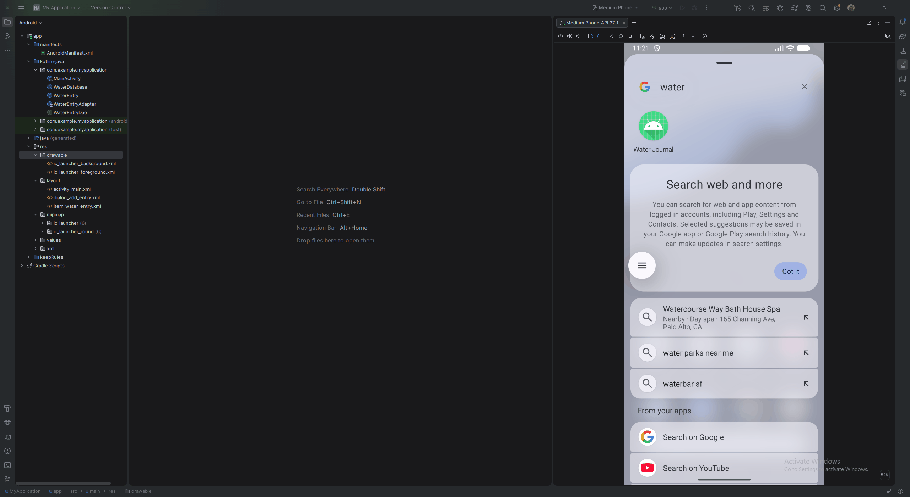

# Android Project 5 - *Water Journal*

Submitted by: **Jacob Hermsmeyer**

**Water Journal** is a health metrics app that lets users log water consumed in milliliters, add optional notes, see today's total, and browse past entries offline.

Time spent: **4** hours spent in total

## Required Features

The following **required** functionality is completed:

- [x] **At least one health metric is tracked (based on user input)**
  - Chosen metric(s): Water consumption (milliliters)
- [x] **There is a "create entry" UI that prompts users to make their daily entry**
- [x] **New entries are saved in a database and then updated in the RecyclerView**
- [x] **On application restart, previously entered entries are preserved (i.e., are *persistent*)**

The following **optional** features are implemented:

- [ ] **Create a UI for tracking averages and trends in metrics**
- [x] **Improve and customize the user interface through styling and coloring**
- [ ] **Implement orientation responsivity**
- [ ] **Add a daily photo feature**

The following **additional** features are implemented:

- [x] Show the total amount of water logged today.
- [x] Save an optional note and timestamp with each entry.

## Video Walkthrough

## Notes

The debug APK builds successfully with `:app:assembleDebug --offline` and launches in the Medium Phone emulator. Room stores entries in a named local database and reloads them when the activity starts. A device restart test has not been run.

## License

    Copyright 2002 Jacob Hermsmeyer

    Licensed under the Apache License, Version 2.0 (the "License");
    you may not use this file except in compliance with the License.
    You may obtain a copy of the License at

        http://www.apache.org/licenses/LICENSE-2.0

    Unless required by applicable law or agreed to in writing, software
    distributed under the License is distributed on an "AS IS" BASIS,
    WITHOUT WARRANTIES OR CONDITIONS OF ANY KIND, either express or implied.
    See the License for the specific language governing permissions and
    limitations under the License.
